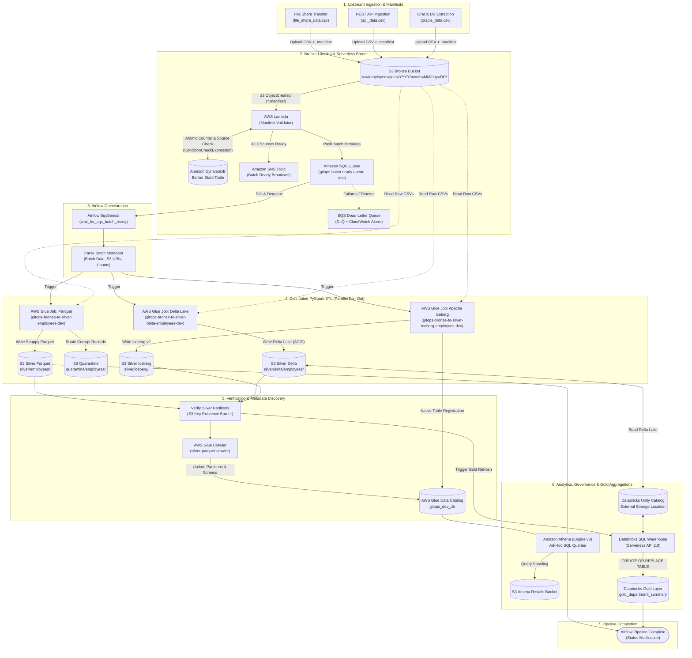

# AWS Modern Data Platform (GitOps Monorepo)

A production-ready, GitOps-driven blueprint for a Modern Data Platform on AWS, featuring Medallion architecture (Bronze/Silver/Quarantine), event-driven ingestion, PySpark batch transformations on AWS Glue, Athena ad-hoc querying, Apache Airflow orchestration, Databricks Unity Catalog, and Snowflake Zero-Copy Apache Iceberg Integration.

---

## Repository Map

```text
.
├── .github/
│   └── workflows/             # CI/CD pipelines (Lint, Test, Terraform Plan/Apply) [Phase 10]
├── airflow/
│   ├── dags/                  # Airflow DAGs for pipeline orchestration [Phase 7]
│   ├── plugins/               # Custom Airflow plugins and operators [Phase 7]
│   ├── tests/                 # Airflow DAG integrity and unit tests [Phase 7]
│   └── requirements.txt       # Airflow package and provider dependencies
├── src/
│   ├── lambda/                # Serverless event handlers & ingestion triggers [Phase 5]
│   └── glue/
│       ├── common/            # Shared PySpark schemas, utilities, and validation logic [Phase 6]
│       └── jobs/              # AWS Glue PySpark transformation scripts [Phase 6]
├── terraform/
│   ├── modules/               # Reusable Terraform modules
│   │   ├── s3/                # Bronze, Silver, Quarantine, Athena buckets [Phase 3]
│   │   ├── iam/               # Least-privilege execution roles & OIDC trust [Phase 4]
│   │   ├── lambda/            # SQS-triggered validation Lambda [Phase 5]
│   │   ├── glue/              # Glue Data Catalog & PySpark job definitions [Phase 6]
│   │   ├── sqs/               # S3 ingestion notification queue & DLQ [Phase 5]
│   │   ├── athena/            # Athena workgroup and query results setup [Phase 8]
│   │   ├── databricks/        # Unity Catalog External Locations & Credentials [Phase 8]
│   │   └── snowflake_iam/     # Snowflake Cross-Account IAM role & policies [Phase 9]
│   └── environments/
│       ├── dev/               # Development environment Terraform configuration
│       ├── qa/                # QA / Staging environment Terraform configuration
│       └── prod/              # Production environment Terraform configuration
├── snowflake/
│   ├── rbac/                  # Enterprise RBAC (DATA_ENGINEER, DATA_ANALYST) [Phase 9]
│   ├── stages/                # External Volume & AWS Glue Catalog Integration [Phase 9]
│   └── tables/                # Snowflake Iceberg tables synced with Glue Catalog [Phase 9]
├── sql/
│   └── athena/                # Athena DDL, partition repair, and data quality queries [Phase 8]
├── tests/
│   ├── unit/                  # Python unit tests for Lambda and Glue scripts
│   └── conftest.py            # Global Pytest fixtures and mocked AWS environment
├── scripts/                   # Local automation and environment bootstrapping scripts
├── docs/
│   ├── architecture.md        # Architecture overview and Mermaid data-flow diagram
│   └── runbook.md             # Operational runbook and phase invocation guide
├── .editorconfig              # Code formatting rules
├── .env.example               # Template environment variables
├── .gitignore                 # Version control exclusions
├── .pre-commit-config.yaml    # Pre-commit quality hooks (Ruff, Terraform fmt)
├── Makefile                   # Developer productivity commands (lint, test, tf-validate)
├── PLATFORM_ROADMAP.md        # Master architectural roadmap and phase progress tracker
├── pyproject.toml             # Ruff and Pytest tool configurations
└── README.md                  # Project overview and documentation
```

---

## Quick Start

### 1. Prerequisites
- Python 3.11+
- Terraform 1.5+
- AWS CLI v2 configured with appropriate credentials
- Make

### 2. Environment Setup
```bash
# Clone repository and enter directory
cd gitops_de_blueprint

# Copy environment variables template
cp .env.example .env

# Install dependencies and pre-commit hooks
make install
```

### 3. Developer Tooling Commands
```bash
make help          # View available targets
make lint          # Run Ruff and Terraform fmt checks
make format        # Automatically fix formatting issues
make test          # Execute pytest suite
make tf-validate   # Validate Terraform configurations across environments
```

---

## Incremental Build Roadmap

The platform is designed to be built incrementally across 10 sequential phases. See [PLATFORM_ROADMAP.md](file:///Users/mohammednasirudeen/Documents/Project/Data%20Engineering/gitops_de_blueprint/PLATFORM_ROADMAP.md) for full phase details and [docs/runbook.md](file:///Users/mohammednasirudeen/Documents/Project/Data%20Engineering/gitops_de_blueprint/docs/runbook.md) for trigger instructions.

| Phase | Description | Status |
| :---: | :--- | :---: |
| **Phase 1** | Project Scaffolding & Tooling | **Complete** |
| **Phase 2** | Terraform State Backend & Provider Setup | **Complete** |
| **Phase 3** | S3 Storage Architecture (Bronze / Silver / Scripts / Athena) | **Complete** |
| **Phase 4** | IAM Least-Privilege Roles & Execution Policies | **Complete** |
| **Phase 5** | Event Ingestion (Multi-Source S3 Manifest Barrier / DynamoDB / SQS / SNS) | **Complete** |
| **Phase 6** | Glue PySpark ETL (Snappy Parquet, Delta Lake & Apache Iceberg) | **Complete** |
| **Phase 7** | Airflow Orchestration & Event-Driven Batch Synchronization DAG | **Complete** |
| **Phase 8** | Athena Ad-Hoc Analytics & Databricks Unity Catalog Governance | **Complete** |
| **Phase 9** | Snowflake Zero-Copy Apache Iceberg Integration (Glue Catalog Synced) | **Complete** |
| **Phase 10** | CI/CD Pipelines & Automation | Ready for Deployment |

---

## Software Stack & Version Matrix

| Category | Component / Software | Version / Runtime | Purpose & Role |
| :--- | :--- | :--- | :--- |
| **Orchestration** | **Apache Airflow** | `3.2.0` | Workflow orchestration, SQS sensor, parallel Glue jobs & Databricks triggers |
| | **PostgreSQL** | `16` | Airflow backend relational metadata database |
| | **Redis** | `7.2-bookworm` | Airflow Celery broker for distributed task queue management |
| **Data Processing** | **AWS Glue** | `4.0` | Serverless PySpark distributed compute (2x `G.1X` workers) |
| | **Apache Spark** | `3.3.0` | Distributed transformation engine embedded in Glue 4.0 runtime |
| | **Python** | `>= 3.11` | Primary language for PySpark, Airflow DAGs, and Lambda handlers |
| **Lakehouse Formats** | **Delta Lake** | `2.2.0` | ACID lakehouse table format for Databricks Unity Catalog serving |
| | **Apache Iceberg** | `1.0.0` (Format v2) | Open table format with fan-out writer, registered in Glue Catalog |
| | **Apache Parquet** | Snappy Compressed | Columnar storage format for Athena ad-hoc querying in Silver layer |
| **Analytics & Serving**| **Snowflake** | External Volume + Glue Catalog | Zero-Copy high-performance SQL analytics on Silver S3 Iceberg tables |
| | **Databricks Unity Catalog** | External Location | Centralized enterprise governance & data access control |
| | **Databricks SQL Warehouse** | Serverless (API 2.0) | High-performance BI queries & Gold `department_summary` table refresh |
| | **Amazon Athena** | Engine Version 3 | Serverless interactive SQL ad-hoc analytics over Parquet & Iceberg |
| | **AWS Glue Data Catalog** | Hive Metastore API | Centralized metadata store for tables, schemas, and partitions |
| **AWS Serverless Barrier**| **AWS Lambda** | `Python 3.11` | Manifest validator event handler triggered by S3 `ObjectCreated` |
| | **Amazon DynamoDB** | On-Demand (Pay/Req) | Multi-source batch barrier state coordination with atomic locking |
| | **Amazon SQS** | Standard + DLQ | Decoupled event buffering; `gitops-batch-ready-queue-dev` triggers Airflow |
| | **Amazon SNS** | Standard (KMS SSE) | Fan-out event broadcasting & operational failure alerting |
| | **Amazon CloudWatch** | Alarms & Logs | SQS DLQ failure alarms & 14-day retained execution logging |
| **Infrastructure as Code**| **Terraform** | `>= 1.5.0` | Declarative cloud resource provisioning |
| | **AWS Provider** | `~> 5.0` (v5.x) | HashiCorp AWS provider managing S3, IAM, Lambda, SQS, SNS, Glue |
| | **Databricks Provider** | `>= 1.40.0` | Terraform provider managing Unity Catalog, credentials & locations |
| **Developer Tooling** | **AWS CLI** | `v2` | Command-line interface for AWS service verification |
| | **Ruff** | `>= 0.4.0` | Ultra-fast Python linter and code formatter |
| | **Pytest** | `>= 8.0.0` | Unit, integration, and DAG integrity test suite |
| | **Pre-commit** | `>= 3.7.0` | Multi-language Git pre-commit hook framework |
| | **Docker & Compose** | Compose v2 | Containerized local execution for Airflow, Postgres, and Redis |

---

## End-to-End Architecture Flow

The platform implements an **Event-Driven Multi-Source Synchronization Barrier Pattern** combined with a **Polyglot Lakehouse Serving Architecture** (Snappy Parquet, Delta Lake, and Apache Iceberg).

### Architectural Data Flow Diagram



### End-to-End Lifecycle Phases

1. **Phase 1: Multi-Source Landing (Bronze Tier)**
   - External data providers (File Share, REST API, Oracle Ingestion) independently write partitioned CSV data and zero-byte/JSON manifest markers (`.manifest`) into `s3://gitops-bronze-bkt-dev-790347819012/raw/employees/year=YYYY/month=MM/day=DD/source=<source_name>/`.
2. **Phase 2: Serverless Barrier Synchronization**
   - The S3 `ObjectCreated` event activates the **AWS Lambda Manifest Validator**.
   - Lambda utilizes **Amazon DynamoDB** (`gitops-manifest-barrier-state-dev`) with conditional writes (`attribute_not_exists`) as an atomic barrier.
   - When all 3 sources (File Share, API, Oracle) are registered for the target date, Lambda creates a consolidated payload and dispatches a `BATCH_READY` message to **Amazon SQS** (`gitops-batch-ready-queue-dev`) and broadcasts to **Amazon SNS**.
3. **Phase 3: Airflow Orchestration Sensor**
   - Apache Airflow DAG `event_driven_batch_workflow` monitors SQS using `SqsSensor`.
   - Upon receiving the message, it deletes the SQS message and parses the batch metadata (date, S3 prefixes, source record counts).
4. **Phase 4: Parallel PySpark Transformations (AWS Glue)**
   - Airflow triggers 3 parallel AWS Glue 4.0 jobs:
     - **Job A (`bronze_to_silver`)**: Cleans, casts schemas, deduplicates, writes Snappy Parquet to `silver/employees/`, and isolates invalid rows to `s3://gitops-quarantine-bkt-dev/`.
     - **Job B (`bronze_to_silver_delta`)**: Transforms data and writes ACID Delta Lake format to `silver/delta/employees/`.
     - **Job C (`bronze_to_silver_iceberg`)**: Ingests into Apache Iceberg table format v2 at `silver/iceberg/` registered in the Glue Catalog.
5. **Phase 5: Partition Discovery & Verification Barrier**
   - Airflow executes `verify_silver_partitions` ensuring all files are persisted.
   - Airflow triggers the **AWS Glue Crawler** to discover newly added Parquet partitions and synchronize the AWS Glue Data Catalog.
6. **Phase 6: Multi-Engine Querying & Gold Mart Refresh**
   - **Ad-Hoc SQL**: Amazon Athena executes verification queries against `gitops_dev_db.silver_employees` and spools results to the Athena results bucket.
   - **Enterprise BI & Governance**: Airflow executes Databricks SQL Warehouse API call. Databricks accesses Delta Lake through **Unity Catalog External Locations** and creates/refreshes the Gold summary table (`gold_department_summary`).
   - **Zero-Copy Cloud Data Warehouse**: Snowflake queries `ANALYTICS_DEV.SILVER_ICEBERG.employees_iceberg` directly over Amazon S3 using **External Volumes** and **AWS Glue Catalog Integration** with zero data duplication.

---

## Phase 9: Snowflake Zero-Copy Apache Iceberg Integration

The platform provides a production-grade, zero-copy connection between Snowflake and the Apache Iceberg Silver layer on Amazon S3, cataloged directly via AWS Glue.

### Architectural Highlights

- **Zero-Copy Lakehouse**: PySpark writes Iceberg v2 Parquet data once into `s3://gitops-silver-bkt-dev-790347819012/iceberg/` and updates the AWS Glue Catalog (`gitops_dev_db.employees_iceberg`). Snowflake queries the open format in place with sub-second performance.
- **Dual External ID IAM Security Handshake**:
  - Snowflake External Volume (`STORAGE_AWS_EXTERNAL_ID`): Grants secure S3 storage read/probe access.
  - Snowflake Catalog Integration (`GLUE_AWS_EXTERNAL_ID`): Grants secure AWS Glue metadata synchronization.
  - Both IDs are bound within a single least-privilege cross-account IAM role: `gitops-snowflake-iceberg-role-dev`.
- **Infrastructure as Code**: Provisioned and managed entirely via [`terraform/modules/snowflake_iam/`](file:///Users/mohammednasirudeen/Documents/Project/Data%20Engineering/gitops_de_blueprint/terraform/modules/snowflake_iam/).
- **Enterprise RBAC**: Segregates full pipeline engineering privileges (`DATA_ENGINEER_ROLE`) from read-only analytical consumers (`DATA_ANALYST_ROLE`).

### Quick Snowflake SQL Verification

```sql
-- 1. Inspect Table Structure & Partitions
DESC ICEBERG TABLE ANALYTICS_DEV.SILVER_ICEBERG.employees_iceberg;

-- 2. Query Data in Place (Zero Ingestion Cost)
SELECT * FROM ANALYTICS_DEV.SILVER_ICEBERG.employees_iceberg LIMIT 10;

-- 3. Department Analytics
SELECT 
    department,
    COUNT(*) AS total_employees,
    ROUND(AVG(salary), 2) AS avg_salary
FROM ANALYTICS_DEV.SILVER_ICEBERG.employees_iceberg
GROUP BY department
ORDER BY avg_salary DESC;

-- 4. Operational Refresh (Triggered via Airflow DAG or manual on new batch)
ALTER ICEBERG TABLE ANALYTICS_DEV.SILVER_ICEBERG.employees_iceberg REFRESH;
```

---

## Architectural Documentation & Dashboard

For deeper exploration:
- **Interactive Light-Theme Dashboard**: Open [docs/index.html](file:///Users/mohammednasirudeen/Documents/Project/Data%20Engineering/gitops_de_blueprint/docs/index.html) in your browser for interactive node inspection and data payloads.
- **Deep-Dive Architecture Spec**: Refer to [docs/architecture.md](file:///Users/mohammednasirudeen/Documents/Project/Data%20Engineering/gitops_de_blueprint/docs/architecture.md).

---

## Observability & Production CloudWatch Dashboard

The platform includes a unified, production-grade AWS CloudWatch dashboard: **`gitops-data-platform-dashboard-dev`** (`arn:aws:cloudwatch::790347819012:dashboard/gitops-data-platform-dashboard-dev`).

### Dashboard Structure & Widgets

| Section | Widgets & Metrics | Purpose & Failure Assessment |
| :--- | :--- | :--- |
| **🚨 Alarms & KPIs** | • SQS DLQ Messages Alarm & Lambda Error Alarm<br/>• Single-value counters: DLQ Depth, SQS Ready Depth, Lambda Runs/Errors | Immediate executive health overview; visual alert if DLQ > 0 or Lambda errors exist. |
| **🔍 Root-Cause Analysis** | • **Logs Insights Widget**: Live Lambda tracebacks & errors<br/>• **Logs Insights Widget**: Live Glue PySpark ETL error logs (`/aws-glue/jobs/error`) | Instant real-time root-cause analysis without manually browsing CloudWatch Log Groups. |
| **⚡ Serverless Barrier** | • Lambda Invocations vs Errors vs Throttles (Dual Y-Axis)<br/>• Lambda Latency Duration (Average, p90, Maximum ms) | Identifies concurrency throttles, memory timeouts, and ingestion spikes. |
| **📦 State & Messaging** | • DynamoDB Barrier Consumed Units & Operation Latency<br/>• SQS Queue Depths: Active vs In-Flight vs DLQ<br/>• SQS Message Traffic Lifecycle: Sent vs Received vs Deleted | Ensures multi-source synchronization barrier is completing atomically. |
| **📣 Event Broadcasts** | • Amazon SNS: Batch Events Published & Delivered vs Delivery Failures<br/>• SNS Pipeline Operational Incident Alerts | Tracks decoupled event fan-out health and operational alert delivery. |
| **⚙️ PySpark Distributed ETL**| • AWS Glue Tasks: Completed vs Failed tasks per job (Parquet, Delta, Iceberg)<br/>• AWS Glue Job Duration (Elapsed execution seconds) | Assesses distributed worker performance and individual transformation job health. |
| **📊 Analytics & Lakehouse** | • Amazon Athena: Processed Bytes & Query Execution Duration<br/>• S3 Storage Metrics: Bucket Sizes & Object Counts (Bronze / Silver) | Monitors query costs, execution latencies, and daily lakehouse data accumulation. |
| **🛠️ Operational Runbook** | • Actionable CLI commands for DLQ redrive, log streaming, and DynamoDB inspections | Built-in troubleshooting playbook for rapid on-call triage. |

#### Quick CLI Access
```bash
# View dashboard summary in terminal
aws cloudwatch get-dashboard --dashboard-name "gitops-data-platform-dashboard-dev" --region ap-south-1

# View active platform alarms
aws cloudwatch describe-alarms --alarm-name-prefix "gitops" --region ap-south-1
```


---

## Git Workflow

```bash
# 1. Check changed files
git status

# 2. Stage changes
git add .

# 3. Commit
git commit -m "until SQS, SNS iceberg - cloudwatch"

# 4. Push to GitHub
git push
```